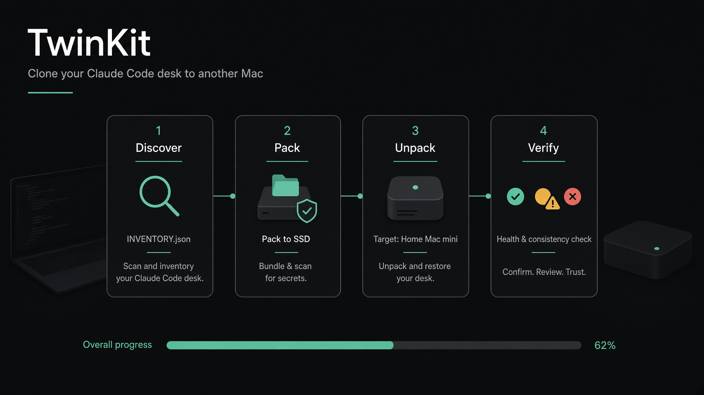
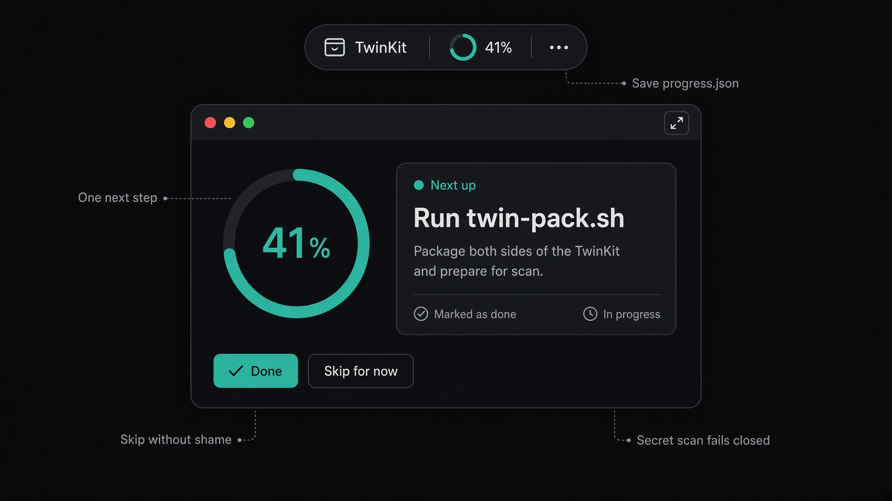
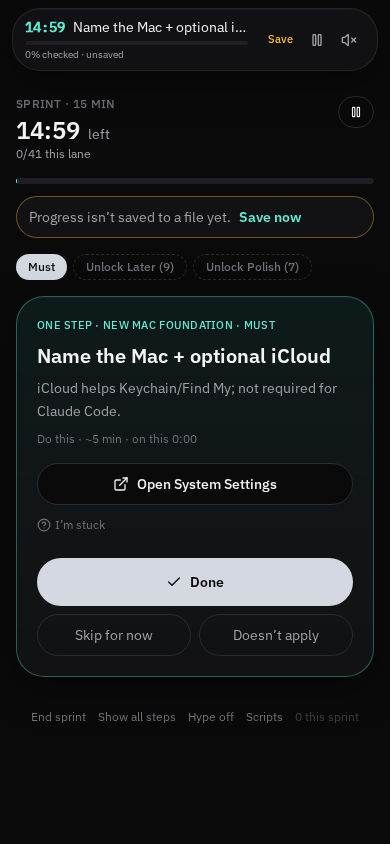
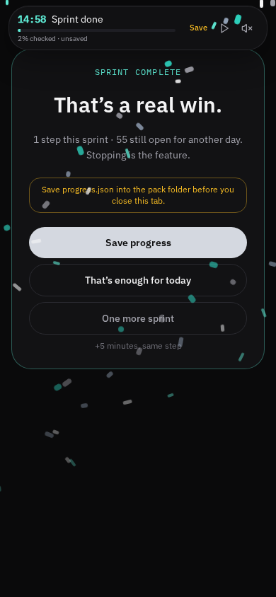
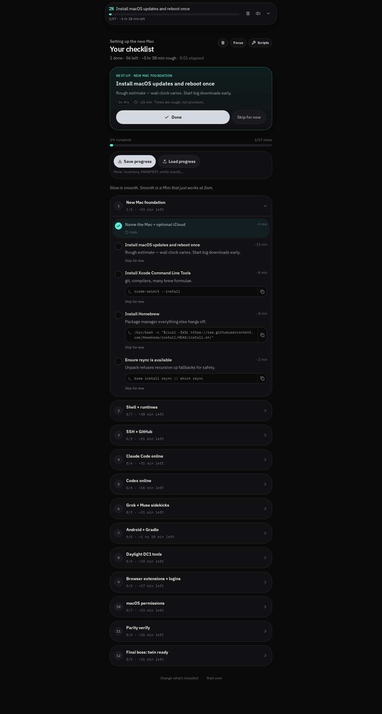
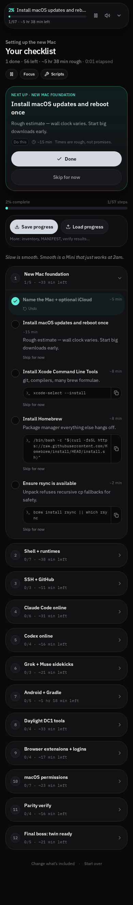

# TwinKit

**Clone your Claude Code (and Codex) desk onto the Mac you leave at home.**

You still sign in yourself. TwinKit keeps the mountain from becoming a fog.



| | |
| --- | --- |
| **Version** | 0.6.0 |
| **What it is** | Four Terminal scripts + a timed checklist in the browser |
| **Who it’s for** | People whose *primary* Claude Code environment is a Mac, cloning it to a Mini / Studio / spare |
| **What it is not** | Auto-login, a native menu bar app, or live SQLite sync while apps are open |
| **License** | MIT |

---

## Install (10 seconds, no Node)

```bash
curl -fsSL https://raw.githubusercontent.com/a12k-a2b/twinkit/main/install.sh | bash
```

That puts `twin-discover`, `twin-pack`, `twin-unpack`, and `twin-verify` in `~/.twinkit` and (if it can) on your PATH via `~/.local/bin`.

Checklist app:

```bash
git clone https://github.com/a12k-a2b/twinkit.git
cd twinkit
npm install
npm run dev
```

To host the checklist at `https://a12k-a2b.github.io/twinkit/`, turn on **Settings → Pages → GitHub Actions** once. The workflow is already in the repo.

---

## What you actually do

```
  OLD MAC (the one that works)          NEW MAC (home Mini / Studio)
  ─────────────────────────────         ─────────────────────────────
  1. twin-discover                      4. twin-unpack --dry-run PACK
  2. twin-pack                          5. twin-unpack PACK
     → ~/Desktop/twinkit-pack-*         6. twin-verify PACK
  3. AirDrop / FileVault SSD  ───────►  7. Re-login + Mac permissions
                                        8. Sprint the checklist until done
```

TwinKit redacts shell rc files, skips known credential filenames, and scans the pack for common secret patterns. This is **best-effort, not a guarantee** — the pack can still contain sensitive configuration (git config, tool JSON, Gradle init scripts). Treat the pack folder as secret: keep it on a FileVault volume and delete it after transfer. You still sign into Claude, Codex, Chrome, and click Allow on Accessibility yourself.



### 1. Pick a lane (30 seconds)

| You are on… | Mode | Scripts |
| --- | --- | --- |
| The Mac that already works | **Pack** | `twin-discover` → `twin-pack` |
| The new Mini / Studio / spare | **Unpack** | `twin-unpack` → `twin-verify` |

Desk types (don’t overthink it):

| Desk | Includes |
| --- | --- |
| **Agents** | Claude + Codex, Chrome logins, permissions, SSH |
| **Agents + CLIs** | Above + Grok Build + Muse Spark |
| **Full lab** | Above + Android / Gradle + Daylight DC1 |

### 2. Sprint (the whole product)

Pick 15 / 30 / 60 minutes (or a 25-min body double). TwinKit shows **exactly one step**:

- **Done**
- **Skip for now**
- **Doesn’t apply** (hard skip — no second confession)
- On-card **Download script / Copy command / Open System Settings / Open sign-in**

Timer ends → win screen + save `progress.json`. Stopping is the feature.

| Lane | Meaning |
| --- | --- |
| **Must** | Agents actually work |
| **Later** | Android / Daylight DC1 |
| **Polish** | Grok, Muse, extras |



### 3. Move the pack

`twin-pack` writes `~/Desktop/twinkit-pack-<stamp>/`:

| File | Purpose |
| --- | --- |
| `MANIFEST.md` | Host, arch, tool versions |
| `progress.json` | Checklist state you Load on the other Mac |
| `SECRETS_REPORT.md` | Pattern hits (pack **exits 2** unless you force-allow) |
| `claude/`, `codex/`, `dotfiles/`, `brew/` | Configs (redacted shell rc, **no private keys**) |

Prefer a **FileVault SSD** over iCloud Drive.

### 4. Unpack + prove it

```bash
twin-unpack --dry-run ~/Desktop/twinkit-pack-*
twin-unpack           ~/Desktop/twinkit-pack-*
twin-verify           ~/Desktop/twinkit-pack-*
```

Then the boring human part: Claude login, Codex login, Chrome extensions, **Accessibility / Screen Recording / Files and Folders**.



---

## Screenshots

| Desktop | Mobile |
| --- | --- |
|  |  |

---

## What’s in this repo

```
install.sh                 curl | bash — scripts + TwinKit Sync, no Node
public/twinkit/            twin-discover / pack / unpack / verify + twinkit / twinkit-sync
sync/                      TwinKit Sync (python3) — lock, rewrite, bounce, adapters
sync/launchd/              3h idle-gated + nightly deep plist templates
src/components/twinkit/    Welcome, Sprint, Toolkit, HUD, win screen
src/lib/twinkit/           Checklist, store, pack script source, presets
docs/                      README screenshots + SYNC.md
```

Full source. If a clone looks empty, you’re on an old commit — `git pull`.

---

## Scripts

| Command | Does |
| --- | --- |
| `twin-discover` | Inventory tools + Daylight-ish paths → `INVENTORY.json` |
| `twin-pack` | rsync configs, redact rc, secret scan, write `progress.json` |
| `twin-unpack` | Restore with `.twinkit-backup`; supports `--dry-run` |
| `twin-verify` | Compare MANIFEST vs this Mac → `PARITY.md` + `PARITY.json` |

Pack **requires `rsync`**. There is no `cp -R` fallback.

Safety (non-negotiable):

- Shell rc is **redacted** by default (`TWINKIT_PACK_RAW_RC=1` to keep raw)
- Secret patterns (`sk-`, `ghp_`, `ghu_`, `xai-`, `AKIA`, private key banners, …) **fail the pack** unless `TWINKIT_ALLOW_SECRETS=1`. Hits are stored as path:line:pattern-id only; the pack is renamed `…-UNSAFE-DO-NOT-TRANSFER`
- SSH **public** keys only
- Claude / Codex credential filenames are skipped; this is not a guarantee

---

## Claude Code skill

Installer copies this if `~/.claude` exists. Otherwise:

```bash
mkdir -p ~/.claude/skills/twinkit-migrate
cp ~/.twinkit/SKILL.md ~/.claude/skills/twinkit-migrate/SKILL.md
```

---

## TwinKit Sync (2–3 Macs)

One-shot pack clones a desk. **TwinKit Sync** keeps Cursor / Codex / Claude Code / Antigravity state moving between Macs you already use — Air (`/Users/anjan`), mini (`/Users/anjanmacmini`), optional 3rd — with an exclusive lock and an **idle bounce** because those apps stay open.

```bash
twinkit sync init --machine air          # or mini / other
twinkit sync checkout                    # this desk owns live harnesses
# …work…
twinkit sync bounce                      # quit-if-idle → pack → vault → import → relaunch
twinkit sync release                     # pack + push + unlock (desk switch)
twinkit sync schedule install            # launchd: 3h idle-gated + nightly deep
twinkit sync doctor
```

Notification after a bounce: **TwinKit Sync bounced Cursor+Codex**.

| | |
| --- | --- |
| Transport | Private **git vault** (best for 3 machines) or a local **Syncthing** folder |
| Path rewrite | Mandatory on import. Air `/Users/anjan` is a prefix of mini `/Users/anjanmacmini` — replacement is boundary-aware. Optional canon root: `/Users/Shared/Projects` |
| Excluded | `auth.json`, Keychain, glass locks (`~/.daylight/glass`), adb, credentials, statsig, WAL/SHM, huge caches |
| Codex size | `sessions: last_N_days` (default 30); `--deep` for a nightly full tree |
| Idle bounce | No agent children, session files quiet ≥ 15 min, conservative CPU/network. Refuses if mid-run. `--now --force` quits even when not idle |

Full guide, pairing, heuristics, and prior-art credits: **[docs/SYNC.md](docs/SYNC.md)**.

Ideas borrowed (not vendored): TwinKit pack/redact, [cursaves](https://github.com/search?q=cursaves) (Cursor snapshots + “don’t write while running”), codexSync / codex-session-tui (cold Codex + backup-before-overwrite), claudesync / ccsync (allowlists, Syncthing, **root-relative** Claude project identity), Antigravity community rclone cold backup.

---

## Honest limits

| Wanted | Reality |
| --- | --- |
| Native Mac menu bar | Browser HUD while the tab is open. Raycast helper in extras. |
| Clone logins | You must re-auth. OAuth cookies are not packed. |
| Cloud progress | Pack folder `progress.json` is the sync. |
| Perfect Android / Gradle twin | Paths + Brewfile + notes; SDK licenses still human. |

---

## Typical times

| Lane | Catalog |
| --- | --- |
| Pack only | ~45–90 min |
| Unpack + re-auth + permissions | a few hours with coffee |
| Full lab (Android + Daylight) | longer; optional lane — skip without shame |

---

## License

MIT. Treat pack folders as **sensitive config**, not Dropbox souvenirs.
